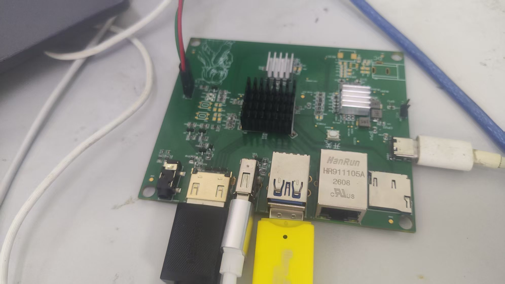
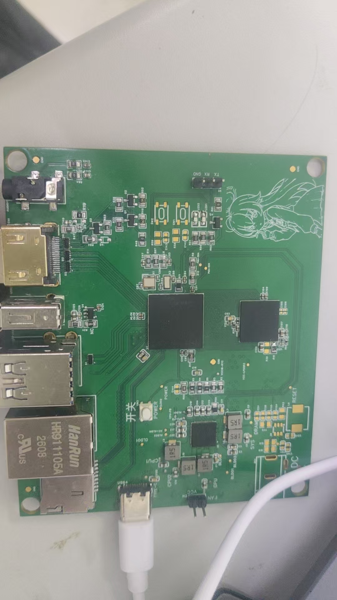
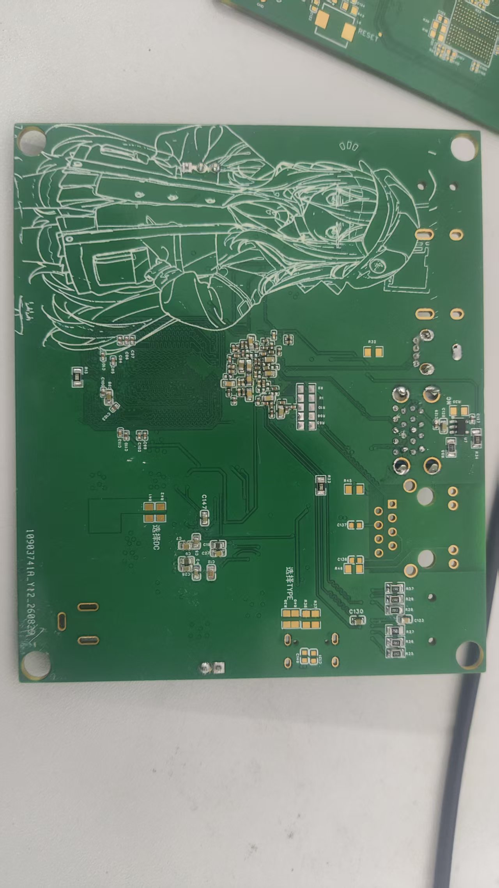
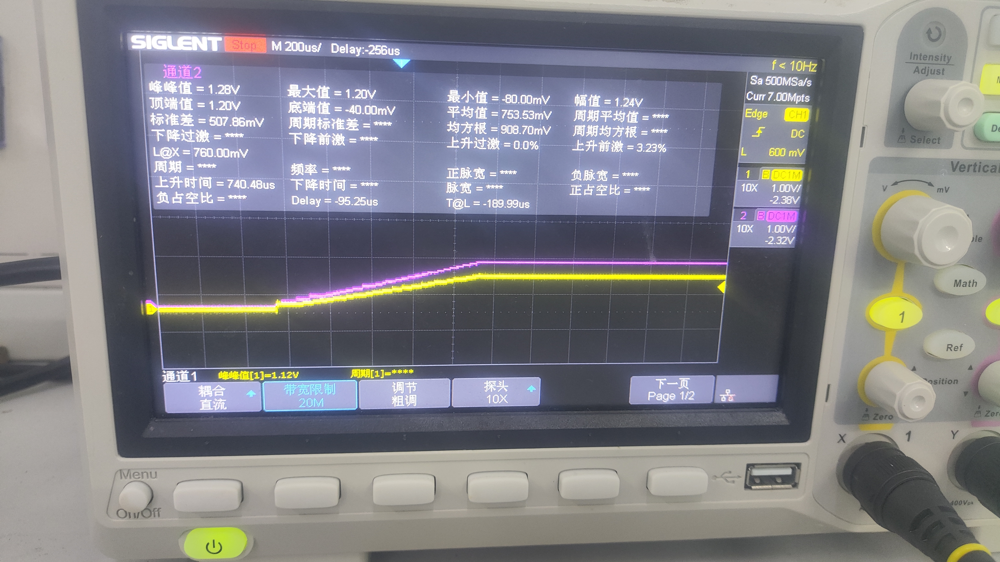
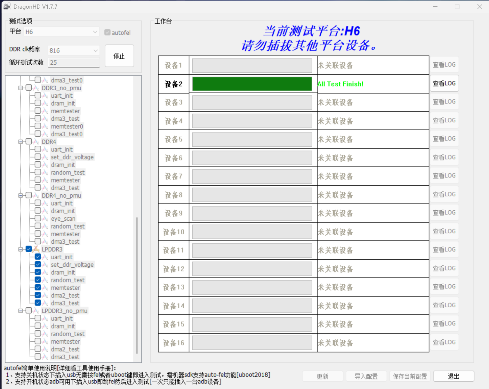
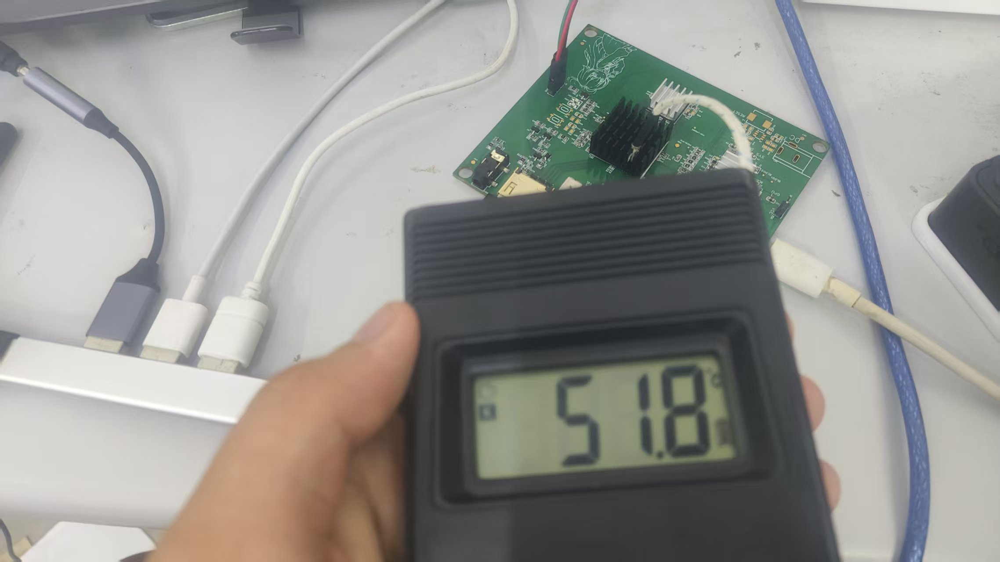
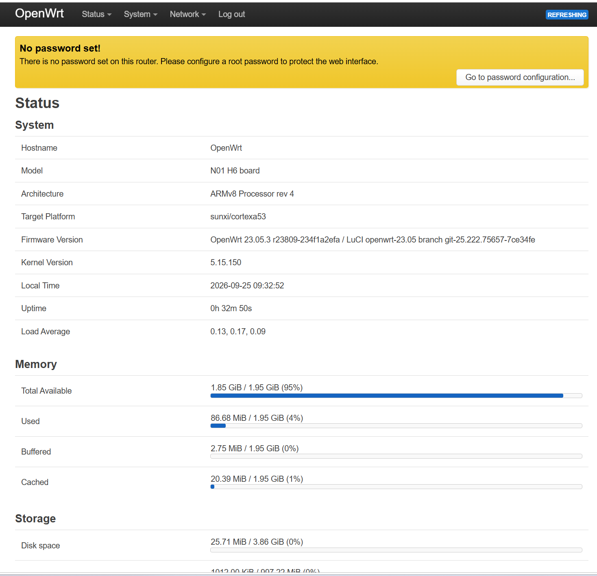

# N01｜全志 H6 Linux 主板

## 为什么做这块板

做过 V3s 之后，我想试着做一块需要外接内存、能跑 Linux 桌面的主板，于是选了全志 H6。这块板叫 N01，原理图、封装、PCB 和板子焊接都是我自己做的。从第一块板的电源异常，到后来能用 HDMI 进 Debian 桌面，中间返修和做实验花的时间，比把板子画出来还长。这里把走过的弯路和实测结果一起放出来，供做 H6 或其他 Linux 主板的人参考。

更加详细和完整的调试与测试文档，请参考我上传的附件，我已经尽力把整个全部的流程用文字和图片完整的记录下来了。

我一开始的目标很简单，想让自己画的板接上显示器、插个 U 盘、进终端，最后还能当小电脑用。做到实板上才发现，按下开关以后，先要有正确的供电和复位，随后内存训练得成功，启动程序才有地方放内核。进了系统之后，设备树、驱动和板上的焊接又会一起影响外设。单看其中一层很容易想得太简单，所以我给自己定的顺序是先把板子带起来，再做内存读写，最后逐个接上外设。

本次工程也有很多参考别人设计的地方，其中参考了很多大佬的设计和原厂参考资料，例如这位大佬的设计：

[https://oshwhub.com/logicworld/h6_board?jspm=hub.ss.lb.gc1&jlc_vid=FlRYVQBeQQBbV1ZUQlFeVlRQQVINVlBfFlUNAQFVRgMxVlNfQlNbXlRfRllWUTtWKAkaExQVTU5BCBcOAAkbBUoFGAw%3D](https://oshwhub.com/logicworld/h6_board)

## 硬件设计和装配

主控为全志 H6，配 AXP805 电源管理芯片和三星 K4E6E304EC-EGCG LPDDR3，设计容量 2 GiB。板上引出了 HDMI、SD 卡、三个 USB 接口和调试串口，也做了通过 H6 封装内 AC200 的百兆以太网与模拟音频输出。板上没有 Wi-Fi 或蓝牙模组，无线测试用的是外接 USB 网卡。

外置内存是这次和 V3s 区别最大的地方。要把 32 位 LPDDR3 接起来，封装方向、引脚对应关系、PCB 走线、焊接和启动参数得一起看。比如后面启动程序能报告容量，我可以先继续找下一阶段的错误，但如果读写测试没过，还是要回到内存这一边。电源部分也遇到过类似的名字问题，软件兼容项有时会写 AXP806 或 AXP80x，板上实际装的器件是 AXP805，核对供电时我以实际工程和器件为准。

## 前几块板怎么翻车的

我用钢网和锡膏做贴装，焊 BGA 时用恒温加热台，另外用热电偶观察实际温度。第一块板上电前只贴了 AXP805、阻容、电感和按键，H6 还没焊。我原本想先把电源部分单独测完，谁知道 CPU 和 GPU 电源的反馈取样路径经过主控一侧，按这时的装配状态根本没闭合。那一次测到 CPU 和 GPU 两路分别到了约 4.5 V 和 3.5 V，后来 CPU 反馈节点对地也接近短路。这两个数是故障时的读数。反馈没有闭合能解释为什么要重新核对供电，但第一块板最终在哪里损坏，我没有拿到足够证据。

第二块我处理了反馈连接再测，VINT 能到约 1.8 V，电源状态信号只有约 0.95 V，其他几路没有正常输出。我当时怀疑电源芯片本身，把它拆下来重焊，现象还是没解决。第三次刚贴上背面的去耦电容，就在冷态检查里发现 5 V 对地短路。我边拆边测，拆掉一部分后阻值恢复，换一批电容后才继续补装。回看这几次，我学到的是要记下每次测量时板上到底装了哪些东西。第一块的反馈条件、第二块的异常输出、后来发现的 5 V 短路是不同阶段的记录，硬把它们归成一个故障反而容易误判。

后面我的做法是先测对地阻值，再按装配状态核对反馈连接，最后用示波器逐路测上电。两通道示波器分别采集不同电源组合，用 GPU 电源作共同参考看先后。下面是一次 GPU 与 DRAM 电源的实测波形。

VINT 那一路让我意识到万用表的稳态读数会漏掉什么。万用表上最终在 1.8 V 左右，示波器却能看到启动中有一段更高的平台。我换过探头通道，也查过补偿和接地，再把它当成一段单独的上电现象记下来。GPU、内存电源和复位用了几次单独采集，我只用它们判断各路是否拉起来、复位是否有释放，并保留不同次采集的边界。这样后面即使启动失败，至少知道应先看哪一段，不需要每次从猜电源开始。

## 从 FEL 到 LPDDR3 稳定性测试

先用 USB FEL 确认 BootROM 能响应，再下发 SPL 做 DDR 初始化。能识别出 2 GiB 只是第一步，短时间上电读到容量并不能说明长时间读写稳定。我用 DragonHD 在测试界面显示的 816 MHz 下跑完 25 轮，日志每轮识别 2048 MB，四个字节通道的错误计数均为 0，随机读写、memtester、DMA2 和 DMA3 都通过。这个结果对应当时的样板和测试配置，各系统分支有自己的启动参数。

我在笔记里把“FEL 能识别”“SPL 报出容量”“压力测试完成”分别记下来。一开始改频率主要靠 SPL 快速缩小范围，这种方法省时间，但只能说明初始化程序走到了哪里。官方 Android 的首次启动刚好给了一个反例，FES 也曾正确报出 2048 MiB，后面紧跟的简单读写却失败了。不同启动程序走的初始化和训练流程有差异，同一块板出现这两组结果是可以同时成立的。后面的系统调试，就按各自的测试记录写进展，不拿一边的通过记录替另一边兜底。

## 三条系统调试路线

同一块板我先后跑了三套系统。Debian 用来接屏幕和键鼠做桌面实验，OpenWrt 用来试网络系统，全志官方 Android BSP 则用来观察官方驱动和启动流程在自制板上的表现。三条线共用板上的硬件，但每换一次系统，启动程序、设备树和系统盘就得重新配对。

### Debian 12，先看到桌面

Debian 一开始也不是直接亮屏。U-Boot 当时从 USB 盘的启动分区根目录找内核和设备树，我放在了 `/boot/`，后来把实际文件位置和启动脚本对齐才继续往下跑。再往后遇到的是鼠标指针出来、桌面仍黑屏，启用软件渲染才进到 XFCE。板子能跑浏览器和本地播放器已经达到我当时的目标，播放体验还受软件渲染和散热影响。

这条链路要一起核对的有三样，U-Boot 去哪里读 `Image` 和板级设备树，内核用哪个分区当根文件系统，以及 USB 盘上实际是什么布局。后来换系统盘时也碰到过混用构建版本的问题。有的启动配置固定写了另一套系统的根分区，屏幕有输出、内核也起了，还会在找根文件系统时停住。所以我后来每次都先从串口看停在加载文件、挂载根分区还是进桌面，再改对应的一项。

进桌面后我试过网页视频，也试过本地播放器。一次 640×360、24 帧的视频统计已经丢了 495 帧，总数当时为 1047 帧，这个结果可以说明那时的体验确实有卡顿。声音是外接 USB 声卡实际放出来的，因而可以把播放器和 USB 音频这段标记为跑通。散热也用热电偶看过一次，下面照片的 51.8 ℃ 是散热片底部接触点，记录这个读数是为了留住当时的测量位置和条件。

这时跑的是 Linux 6.12.109 和 Debian 12。每次启动从电脑通过 FEL 把 U-Boot 送进内存，再由 U-Boot 读 USB 盘。这种方法在开发阶段很方便，手里留一套已知能启动的组合，试错时退回去就能继续看串口。蓝色接口上的 U 盘在这一阶段走的是 USB 2.0 兼容通道，串口启动和桌面实验就用这条已经跑通的链路。

### OpenWrt，从串口到 LuCI

板子能跑通桌面后，我又做了一份 OpenWrt 23.05.3 系统盘，内核为 Linux 5.15.150。这条线从串口进入命令行，先确认系统和存储，再接 USB 无线网卡。下图是 9 月无线接入成功时留下的 LuCI 页面。

我用 USB 接 RT5370，9 月先看到了网卡识别，然后才逐项验证扫描、无线关联、地址分配、域名解析和访问网页。这样一轮下来，也能从电脑进 LuCI 管理页面。10 月重新拿出板子时，我先用 F1C200S 网关读串口，再用电脑直连复核，确认 OpenWrt 能再次进入命令行。网卡后来却出现反复断开和读描述符错误，有一次重进系统查不到无线接口。两次现象都保留，免得一张成功登录 LuCI 的截图把复测故障盖过去。

## 用全志官方 BSP 做 Android 启动实验

跑通 Debian 之后，我还想看看官方软件栈在同一块板上的表现，尤其是它对电源、音频和以太网的初始化。为此我在隔离的旧版 Linux 环境搭起全志官方 Android N BSP 的构建工具，做了 N01 的板级配置和启动适配。USB 系统盘上留了已有的 Linux 数据区，再为 Android 划分空间。每次下发启动程序前先确认分区对应的系统，避免前面已经跑通的 Debian 被下一轮测试覆盖。

Android 分支第一个卡点是 FES 启动时的 DDR 自检。自动选到 744 MHz 时，容量能读出来，随后的简单读写失败。把频率设为 720 MHz，同时调整一组初始化参数后，几次冷启动都通过了 FES 的短自检。这里改了不止一个变量，所以结果只对应这组配置，单独哪项参数起了决定作用还无法确认。

第二个卡点是 FEL 交接。文件都传完了，执行下一阶段却超时。对照源码、链接地址和内存分布，发现原先的第二阶段装载地址会碰到 H6 BootROM 用于 FEL 的栈区。调整装载、链接和入口地址，再补回链接时被丢掉的段，串口才出现交接成功的输出，接着走到官方 U-Boot 和 Linux 内核。

Android 的启动等了约 15 分钟。翻串口才看到有多次约 5 秒的 AC200 I²C 超时，累计起来拖了很久。最后能进入 Android 串口 shell，也看到 zygote、surfaceflinger 等服务有启动记录。系统的启动完成标志当时还没出现，所以这条路线的实测结果就写到串口 shell 为止。全志官方 BSP 用于构建与对照调试，官方源码、衍生文件和镜像不随工程分发。

## 顺着 AC200 的初始化往下查

在主线内核那条路线里，给冷启动探测加有限重试之后，AC200 能被识别，声卡也能列出来。真正试播时，驱动还要在播放前设置格式和时钟，一次错误就出在配置 I²S 格式所需的换页写入。后面试过对照 BSP 改换页方式，也试过总线降速。有的改动能启动系统，有的组合还出现过总线锁住，始终没有听到板载模拟口成功出声。百兆网口的驱动也曾绑定，但驱动绑定之后还需要有实际的链路和收发结果。

在 Android 路线，我用官方驱动做了只增加记录的诊断，看到控制器报告 START，驱动接着把地址字节写入数据寄存器，之后直到超时都没看到下一次中断或地址应答状态。这个测点把注意力拉到了更早的阶段。它回答了“驱动记录走到了哪里”，线上究竟有没有完整发出地址、AC200 有没有应答，还需要对应的物理波形。两条路线的错误发生在不同阶段，我保留了各自的日志，先不把问题归到某一个寄存器或元件上。

## 我怎么用 AI 一起调试

板子还是我自己焊、自己量。AI 主要帮我处理一轮轮积起来的日志和配置。例如 Debian 卡在加载内核时，我让它对照 U-Boot 的读取路径、USB 盘目录和设备树文件名，再拿串口输出验证改动。排 AC200 时，我让它对照主线和全志 BSP 的初始化顺序，把复位、时钟、I²C 事务和最终播放分开看。设备能注册、驱动能绑定，和真的有声音或数据通过，中间还有好几步要测。

后来我也用自己的 F1C200S 无线调试网关采集 N01 串口，让 AI 能直接协助读启动日志、对照配置和整理下一轮验证点。OpenWrt 的恢复启动就是一次实际用法，之后我也用电脑直连串口复核过。这套办法可以用在其他有调试串口的 Linux 板上。遇到电压异常、枚举不稳这类问题，最终还是靠示波器、串口和板上实测判断。

对我最有用的是把一段很长的日志变成几个可以回答的问题。比如网卡出不来，先查 USB 有没有枚举，再看驱动有没有加载，最后才轮到关联和联网。或者同一块 U 盘有几套启动包，先把 U-Boot、设备树和根分区配对，再比两次启动的日志。AI 可以很快帮我整理这些线索，但我会追问它对应哪一条原始记录，并把下一轮的实测拿回来对照。这样隔一段时间再捡起项目，比较容易接着上一次的结果继续查。

## 把 N01 当成一块 Linux 实验板

搭好基本的启动链以后，这块板就有了不少可玩的方向。接上 HDMI、键鼠和 USB 声卡，可以在 Debian 上做一个本地界面，试试显示、输入和音频怎样拼起来。换成 OpenWrt，可以拿它练习设备树、USB 网卡和网络服务。平时不用接屏幕，有串口就能看引导日志，起得来以后还可以继续换内核、接新的 USB 外设或跑自己的应用。这些方向共用的是 Linux 提供的驱动和工具，具体能用到哪一步，还得看各自的板级适配和实测。

如果把这次实验接着做下去，我会先把已知能启动的组合固定住，再单独试脱离电脑的上电启动。USB 高速链路和板载 AC200 也可以各自开一轮测试。像这次先用 USB 声卡验证播放器，后来再回过头看模拟输出，就是把两条本来容易混在一起的路径拆开。下一次换板或者换内存颗粒时，前面留下的波形、串口和读写结果还能拿来比较。

随工程整理的是 N01 自己画的嘉立创 EDA 专业版工程，里面有原理图和 PCB。想看供电的话可以从 AXP805 和反馈网络入手，想看外接内存则对照 LPDDR3 原理图与 PCB。前面几块板碰到的故障也都发生在这些实打实的连接上。现阶段我更希望这份工程作为设计和调试参考，我也不推荐去复刻，有缺陷，仅供参考，欢迎与各位大佬交流。

## 工程文件与授权

立创页面见 [N01｜全志 H6 Linux 主板](https://oshwhub.com/a-ordinary-people/project_dbtaimfa)。

| 资料 | 仓库入口 |
| --- | --- |
| 嘉立创 EDA 专业版原理图、PCB 与工程库 | [N01-H6.epro](hardware/easyeda/N01-H6.epro) |
| Altium Designer 工程、七页原理图和 PCB | [N01-H6-Altium.zip](hardware/altium/N01-H6-Altium.zip) |
| 双格式核对和打开方法 | [硬件说明](hardware/README.md) |
| Linux、U-Boot 与 OpenWrt 板级资料 | [软件说明](software/README.md) |

N01 自研原理图与 PCB 采用 [CERN-OHL-W-2.0](LICENSE)。软件文件按各自的许可证和上游声明提供。全志官方 BSP 仅在正文记录使用和调试经历，其源码、衍生文件和镜像均不随仓库分发。

本文由 Codex 编写，作者仅做审核、修改与发布。
